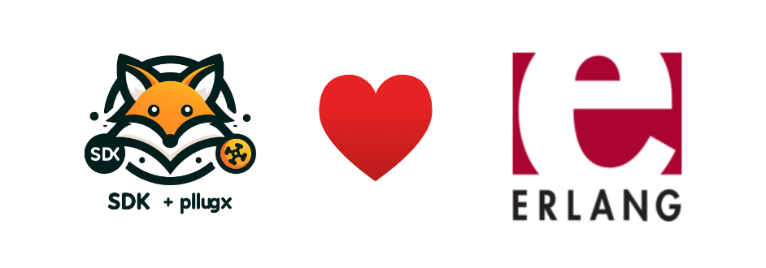

<div align="center">



[](https://github.com/version-fox/vfox-erlang/actions/workflows/lint.yml) [](https://github.com/version-fox/vfox-erlang/actions/workflows/test.yml) [](https://github.com/version-fox/vfox-erlang/actions/workflows/license.yml) [](https://github.com/version-fox/vfox-erlang/actions/workflows/e2e.yml) [](https://github.com/version-fox/vfox-erlang/actions/workflows/e2e_test_darwin.yaml) [](https://github.com/version-fox/vfox-erlang/actions/workflows/e2e_test_darwin_prebuilt.yaml) [](https://github.com/version-fox/vfox-erlang/actions/workflows/e2e_test_darwin_mise.yaml) [](https://github.com/version-fox/vfox-erlang/actions/workflows/e2e_test_linux_mise.yaml)

</div>

# vfox-erlang plugin

[中文](README_CN.md) | [English](README.md)

An [Erlang/OTP](https://www.erlang.org/) plugin for [vfox](https://github.com/version-fox/vfox). It installs and switches between several Erlang/OTP versions on Linux, macOS and Windows: from source, from prebuilt releases, or by linking an Erlang/OTP that is already on the machine.

## Quick start

```shell
# 1. Add the plugin
vfox add erlang

# 2. Find a version and install it
vfox search erlang
vfox install erlang@26.2.3

# 3. Use it globally and check it
eval "$(vfox activate bash)"
vfox use -g erlang@26.2.3
erl -version
```

Linux and macOS build from source by default, so install the build dependencies first, see [docs/source-build.md](docs/source-build.md). For prebuilt releases see [docs/prebuilt.md](docs/prebuilt.md); on Windows see [docs/windows.md](docs/windows.md).

Activation has to run once in each new shell, or be added to `~/.bashrc`, because `vfox use` depends on it. For other shells, see the [vfox quick start](https://vfox.dev/guides/quick-start.html).

## Versions

| Kind | Examples | Where |
| --- | --- | --- |
| Release | `26.2.3` | Linux and macOS (source or prebuilt), Windows |
| Windows release | `25.3.2.12` | Windows, the four-part numbers of the Windows installers |
| Branch or maintenance | `master`, `maint-27` | Linux and macOS (source or prebuilt), not Windows |

Prebuilt branch names on macOS end in `-latest`, for example `maint-27-latest` and `master-latest`.

See [docs/versions.md](docs/versions.md) for searching, installing, switching scopes and branch versions.

## Platforms

| Platform | Default | Alternative | Guides |
| --- | --- | --- | --- |
| Linux | Source build | Prebuilt, `USE_PREBUILT_OTP=ubuntu-22.04` | [source build](docs/source-build.md), [prebuilt](docs/prebuilt.md) |
| macOS | Source build | Prebuilt, `USE_PREBUILT_OTP=true` | [source build](docs/source-build.md), [prebuilt](docs/prebuilt.md) |
| Windows | Official installer | None | [Windows](docs/windows.md) |

Source builds install the EEP-48 documentation chunks, so `h(lists).` works in the Erlang shell.

## Use an Erlang/OTP already on the machine

If Erlang/OTP is already installed, from a distribution package, Homebrew, `make install`, asdf, mise or the Windows installer, vfox can use it instead of building another copy. This needs vfox 1.1.0 or later.

```shell
vfox link --detect erlang      # choose which installations to link
vfox link --detect -y erlang   # link all of them
eval "$(vfox activate bash)"
vfox use -g erlang@26.2.3      # a linked version is named after its OTP version
```

`vfox uninstall` on a linked version only removes the link. See [docs/link.md](docs/link.md).

## Usage with mise

```shell
mise use -g vfox:version-fox/vfox-erlang@26.2.3
mise exec -- erl -version
```

See [docs/mise.md](docs/mise.md).

## Documentation

**Using the plugin**

- [Versions](docs/versions.md): version names, searching, installing, switching scopes and branch versions
- [Building from source](docs/source-build.md): dependencies, `MAKEFLAGS`, `OTP_CONFIGURE_ARGS` and `DOC_TARGETS`
- [Prebuilt releases](docs/prebuilt.md): Linux (Bob) and macOS (erlef/otp_builds) prebuilt installs and `USE_PREBUILT_OTP`
- [Windows](docs/windows.md): the official installer and PowerShell activation
- [Linking installed Erlang/OTP](docs/link.md): using an Erlang/OTP that is already on the machine
- [mise](docs/mise.md): using the plugin through the vfox backend of mise
- [Troubleshooting](docs/troubleshooting.md): common failures and the commands that diagnose them
- [Changes](docs/changes.md): what changed in each release

**Working on the plugin**

- [Development](docs/development.md): how the hooks work, the file layout, checks, website and release
- [E2E tests](docs/e2e.md): what each end-to-end suite covers and how to run the Linux suite locally

## Documentation website

[中文](https://version-fox.github.io/vfox-erlang/) · [English](https://version-fox.github.io/vfox-erlang/en/)

The bilingual site is built from [website/](website/). See [website/README.md](website/README.md) for the local build.

## License

Apache License 2.0. See [LICENSE](LICENSE).

Copyright 2026 vfox-erlang contributors

## Acknowledgements

- [Erlang/OTP](https://github.com/erlang/otp), the source of every release
- [hexpm/bob](https://github.com/hexpm/bob), which builds the Linux prebuilt packages on [builds.hex.pm](https://builds.hex.pm)
- [erlef/otp_builds](https://github.com/erlef/otp_builds), which provides the macOS prebuilt packages
- [vfox](https://github.com/version-fox/vfox), the version manager this plugin runs on
