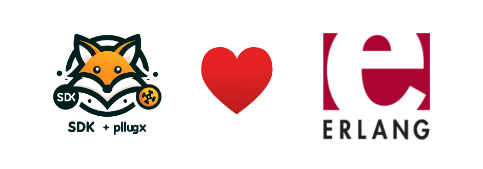

<div align="center">



[](https://github.com/version-fox/vfox-erlang/actions/workflows/lint.yml) [](https://github.com/version-fox/vfox-erlang/actions/workflows/test.yml) [](https://github.com/version-fox/vfox-erlang/actions/workflows/license.yml) [](https://github.com/version-fox/vfox-erlang/actions/workflows/e2e.yml) [](https://github.com/version-fox/vfox-erlang/actions/workflows/e2e_test_darwin.yaml) [](https://github.com/version-fox/vfox-erlang/actions/workflows/e2e_test_darwin_prebuilt.yaml) [](https://github.com/version-fox/vfox-erlang/actions/workflows/e2e_test_darwin_mise.yaml) [](https://github.com/version-fox/vfox-erlang/actions/workflows/e2e_test_linux_mise.yaml)

</div>

# vfox-erlang 插件

[中文](README_CN.md) | [English](README.md)

[Erlang/OTP](https://www.erlang.org/) 的 [vfox](https://github.com/version-fox/vfox) 插件，用于在 Linux、macOS 和 Windows 上安装并切换多个 Erlang/OTP 版本。可以从源码构建，可以安装预编译版本，也可以链接机器上已经装好的 Erlang/OTP。

## 快速开始

```shell
# 1. 添加插件
vfox add erlang

# 2. 查找版本并安装
vfox search erlang
vfox install erlang@26.2.3

# 3. 全局使用并验证
eval "$(vfox activate bash)"
vfox use -g erlang@26.2.3
erl -version
```

Linux 和 macOS 默认从源码构建，所以先安装构建依赖，见 [docs/zh-CN/source-build.md](docs/zh-CN/source-build.md)。预编译版本见 [docs/zh-CN/prebuilt.md](docs/zh-CN/prebuilt.md)；Windows 见 [docs/zh-CN/windows.md](docs/zh-CN/windows.md)。

激活需要在每个新开的 Shell 中执行一次（或写入 `~/.bashrc`），因为 `vfox use` 依赖它。其他 Shell 的激活方法见 [vfox 快速入门](https://vfox.dev/zh-hans/guides/quick-start.html)。

## 版本

| 类型 | 示例 | 适用平台 |
| --- | --- | --- |
| 正式版本 | `26.2.3` | Linux 和 macOS（源码构建或预编译）、Windows |
| Windows 正式版本 | `25.3.2.12` | Windows，使用 Windows 安装器的四段版本号 |
| 分支或维护版本 | `master`、`maint-27` | Linux 和 macOS（源码构建或预编译），不支持 Windows |

macOS 预编译的分支名以 `-latest` 结尾，例如 `maint-27-latest` 和 `master-latest`。

搜索、安装、切换作用域和分支版本的说明见 [docs/zh-CN/versions.md](docs/zh-CN/versions.md)。

## 平台支持

| 平台 | 默认方式 | 可选方式 | 指南 |
| --- | --- | --- | --- |
| Linux | 源码构建 | 预编译，`USE_PREBUILT_OTP=ubuntu-22.04` | [源码构建](docs/zh-CN/source-build.md)、[预编译](docs/zh-CN/prebuilt.md) |
| macOS | 源码构建 | 预编译，`USE_PREBUILT_OTP=true` | [源码构建](docs/zh-CN/source-build.md)、[预编译](docs/zh-CN/prebuilt.md) |
| Windows | 官方安装器 | 无 | [Windows](docs/zh-CN/windows.md) |

源码构建会安装 EEP-48 文档块，因此在 Erlang Shell 中可以使用 `h(lists).`。

## 使用机器上已有的 Erlang/OTP

如果 Erlang/OTP 已经装在机器上（来自发行版软件包、Homebrew、`make install`、asdf、mise 或 Windows 安装器），vfox 可以直接使用它，而不必再构建一份。这需要 vfox 1.1.0 或更高版本。

```shell
vfox link --detect erlang      # 选择要链接的安装
vfox link --detect -y erlang   # 链接扫描到的全部安装
eval "$(vfox activate bash)"
vfox use -g erlang@26.2.3      # 链接的版本以其 OTP 版本号命名
```

对链接的版本执行 `vfox uninstall` 只会删除链接。见 [docs/zh-CN/link.md](docs/zh-CN/link.md)。

## 配合 mise 使用

```shell
mise use -g vfox:version-fox/vfox-erlang@26.2.3
mise exec -- erl -version
```

见 [docs/zh-CN/mise.md](docs/zh-CN/mise.md)。

## 文档

**使用插件**

- [版本](docs/zh-CN/versions.md)：版本名、搜索、安装、切换作用域和分支版本
- [源码构建](docs/zh-CN/source-build.md)：依赖、`MAKEFLAGS`、`OTP_CONFIGURE_ARGS` 和 `DOC_TARGETS`
- [预编译](docs/zh-CN/prebuilt.md)：Linux（Bob）和 macOS（erlef/otp_builds）预编译安装与 `USE_PREBUILT_OTP`
- [Windows](docs/zh-CN/windows.md)：官方安装器和 PowerShell 激活
- [链接已安装的 Erlang/OTP](docs/zh-CN/link.md)：使用机器上已经存在的 Erlang/OTP
- [mise](docs/zh-CN/mise.md)：通过 mise 的 vfox 后端使用本插件
- [问题排查](docs/zh-CN/troubleshooting.md)：常见失败及排查命令
- [变更记录](docs/zh-CN/changes.md)：每个版本的变化

**参与开发**

- [开发](docs/zh-CN/development.md)：钩子的工作方式、文件结构、检查、网站和发布流程
- [E2E 测试](docs/zh-CN/e2e.md)：每个端到端套件覆盖什么，以及如何在本地运行 Linux 套件

## 文档网站

[中文](https://version-fox.github.io/vfox-erlang/) · [English](https://version-fox.github.io/vfox-erlang/en/)

双语网站由 [website/](website/) 构建，本地构建方法见 [website/README.md](website/README.md)。

## 许可证

Apache License 2.0，见 [LICENSE](LICENSE)。

Copyright 2026 vfox-erlang contributors

## 致谢

- [Erlang/OTP](https://github.com/erlang/otp)，所有正式版本的源码来源
- [hexpm/bob](https://github.com/hexpm/bob)，在 [builds.hex.pm](https://builds.hex.pm) 上构建 Linux 预编译包
- [erlef/otp_builds](https://github.com/erlef/otp_builds)，提供 macOS 预编译包
- [vfox](https://github.com/version-fox/vfox)，本插件所依赖的版本管理器
