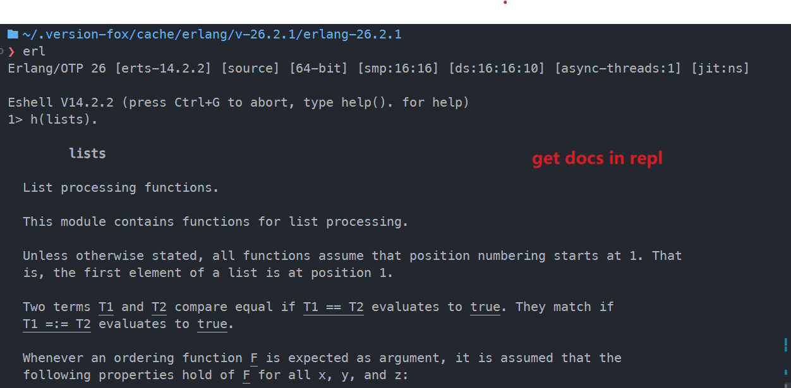

# Building from source

[中文](zh-CN/source-build.md) | [English](source-build.md)

On Linux and macOS, `vfox install` builds Erlang/OTP from source unless `USE_PREBUILT_OTP` is set (see [prebuilt.md](prebuilt.md)). This page lists the build dependencies and the environment variables that change the build.

## What the install does

1. Downloads the source archive from `https://github.com/erlang/otp/archive/`: the tag `OTP-<version>` for a release, or the branch for `master`, `maint` and `maint-<number>` (such as `maint-27`).
2. Runs `./configure --prefix=<sdk>/release`, with the arguments from `OTP_CONFIGURE_ARGS`.
3. Runs `make` and `make install`.
4. Runs `make docs` and `make install-docs` with `DOC_TARGETS`, which defaults to `chunks`.

`<sdk>` is the directory that vfox manages for the version. By default vfox keeps SDKs under `~/.vfox/cache`, see the [vfox configuration guide](https://vfox.dev/guides/configuration.html). The build output goes to `<sdk>/release`, and the plugin adds `<sdk>/release/bin` to `PATH`.

The install path, which is `<sdk>`, must not contain an apostrophe (`'`), a double quote (`"`), a dollar sign (`$`) or a backtick. OTP's `configure` cannot take these characters: an apostrophe breaks its quoting, and the others are expanded. The plugin stops before `configure` starts, and the error names the character. Set `VFOX_HOME` to a path without them. See [troubleshooting.md](troubleshooting.md).

## Dependencies

Ubuntu 22.04:

```shell
sudo apt-get -y install build-essential autoconf m4 libncurses5-dev libwxgtk3.0-gtk3-dev libwxgtk-webview3.0-gtk3-dev libgl1-mesa-dev libglu1-mesa-dev libpng-dev libssh-dev unixodbc-dev xsltproc fop libxml2-utils libncurses-dev openjdk-11-jdk
```

Ubuntu 24.04 uses the same list with two changes: `libwxgtk3.2-dev libwxgtk-webview3.2-dev` replace the 3.0 wxWidgets packages, and `libncurses5-dev` is left out, because Ubuntu 24.04 has no installation candidate for it:

```shell
sudo apt-get -y install build-essential autoconf m4 libwxgtk3.2-dev libwxgtk-webview3.2-dev libgl1-mesa-dev libglu1-mesa-dev libpng-dev libssh-dev unixodbc-dev xsltproc fop libxml2-utils libncurses-dev openjdk-11-jdk
```

macOS, with Homebrew:

```shell
brew install autoconf libxslt fop wxwidgets openssl
```

The utilities and libraries these packages provide:

- `autoconf` (with `m4`) generates the configure script.
- ncurses and the other `-dev` packages provide the headers and libraries that the build compiles against. The OpenSSL headers come from `libssl-dev`, which `libssh-dev` depends on. If `configure` reports that OpenSSL is missing, install `libssl-dev`.
- `xsltproc` is needed by the documentation step; `fop` and OpenJDK are needed for PDF documentation.

## Environment variables

| Variable | Default | Effect |
| --- | --- | --- |
| `MAKEFLAGS` | unset | Passed to `make`, for example `-j8` for parallel jobs |
| `OTP_CONFIGURE_ARGS` | empty | Extra arguments for `./configure` |
| `DOC_TARGETS` | `chunks` | Target for `make docs` and `make install-docs` |

Set them before `vfox install`.

### MAKEFLAGS

A build takes about five minutes on a fast computer. To run `make` in parallel, set `MAKEFLAGS` to `-j` and a number of jobs:

```shell
export MAKEFLAGS=-j8
```

### OTP_CONFIGURE_ARGS

The value is passed to `./configure`. For the available options, see the [OTP installation guide](https://github.com/erlang/otp/blob/master/HOWTO/INSTALL.md#configuring-1).

```shell
export OTP_CONFIGURE_ARGS="--enable-jit --enable-kernel-poll"
```

On macOS, if `configure` cannot find OpenSSL, point it at the Homebrew copy:

```shell
export OTP_CONFIGURE_ARGS="--with-ssl=$(brew --prefix openssl@3)"
```

### DOC_TARGETS

The default `chunks` builds EEP-48 documentation chunks. They let `h(lists).` and `shell_docs` show documentation in the Erlang shell, and let editor language servers show documentation hints. Setting another value changes what `make docs` builds, and `h(lists).` may stop working. Check it after an install, as described below.



## Example

```shell
export MAKEFLAGS=-j8
export OTP_CONFIGURE_ARGS="--enable-jit"
vfox install erlang@26.2.3
```

Then check the install:

```shell
eval "$(vfox activate bash)"
vfox use -g erlang@26.2.3
erl -noshell -eval 'erlang:display({otp_release, erlang:system_info(otp_release)}), halt().'
erl -noshell -eval 'erlang:display(shell_docs:get_doc(lists)), halt().' | grep "functions for list processing"
```

The second command prints a line containing `functions for list processing` when the documentation chunks are installed.

## Changing the build

The variables are read when vfox installs the version. To rebuild an installed version with other settings, uninstall it first:

```shell
vfox uninstall erlang@26.2.3
vfox install erlang@26.2.3
```

## When the build fails

Save the whole output to a file, then read the first error:

```shell
vfox install erlang@26.2.3 2>&1 | tee /tmp/otp-build.log
grep -n -i "error" /tmp/otp-build.log | head -n 20
```

The source tree is in `<sdk>`, so `./configure --help` run there lists the options that `OTP_CONFIGURE_ARGS` accepts. Common causes and fixes are in [troubleshooting.md](troubleshooting.md).
