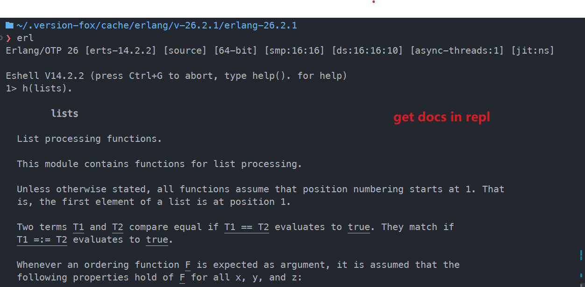

# 源码构建

[中文](source-build.md) | [English](../source-build.md)

在 Linux 和 macOS 上，除非设置了 `USE_PREBUILT_OTP`（见 [预编译](prebuilt.md)），`vfox install` 都会从源码构建 Erlang/OTP。本页列出构建依赖，以及会改变构建过程的环境变量。

## 安装时做了什么

1. 下载源码压缩包，地址为 `https://github.com/erlang/otp/archive/`：正式版本取标签 `OTP-<版本号>`，`master`、`maint` 和 `maint-<数字>`（如 `maint-27`）取对应的分支。
2. 执行 `./configure --prefix=<sdk>/release`，并附加 `OTP_CONFIGURE_ARGS` 中的参数。
3. 执行 `make` 和 `make install`。
4. 使用 `DOC_TARGETS` 执行 `make docs` 和 `make install-docs`，默认值为 `chunks`。

`<sdk>` 是 vfox 为该版本管理的目录。vfox 默认把 SDK 放在 `~/.vfox/cache` 下，见 [vfox 配置文档](https://vfox.dev/zh-hans/guides/configuration.html)。构建产物位于 `<sdk>/release`，插件会把 `<sdk>/release/bin` 加入 `PATH`。

安装路径（即 `<sdk>`）不能包含单引号（`'`）、双引号（`"`）、美元符号（`$`）或反引号。OTP 的 `configure` 无法处理这些字符：单引号会破坏它的引号，其他字符会被展开。插件会在 `configure` 启动之前停止，并指出是哪个字符。请把 `VFOX_HOME` 设为不含这些字符的路径。见 [问题排查](troubleshooting.md)。

## 依赖

Ubuntu 22.04：

```shell
sudo apt-get -y install build-essential autoconf m4 libncurses5-dev libwxgtk3.0-gtk3-dev libwxgtk-webview3.0-gtk3-dev libgl1-mesa-dev libglu1-mesa-dev libpng-dev libssh-dev unixodbc-dev xsltproc fop libxml2-utils libncurses-dev openjdk-11-jdk
```

Ubuntu 24.04 的列表与 22.04 基本相同，有两处不同：`libwxgtk3.2-dev libwxgtk-webview3.2-dev` 替换 wxWidgets 3.0 软件包，并且去掉 `libncurses5-dev`，因为 Ubuntu 24.04 上没有它的安装候选。

```shell
sudo apt-get -y install build-essential autoconf m4 libwxgtk3.2-dev libwxgtk-webview3.2-dev libgl1-mesa-dev libglu1-mesa-dev libpng-dev libssh-dev unixodbc-dev xsltproc fop libxml2-utils libncurses-dev openjdk-11-jdk
```

macOS，使用 Homebrew：

```shell
brew install autoconf libxslt fop wxwidgets openssl
```

这些软件包提供的工具和库：

- `autoconf`（及 `m4`）用于生成 configure 脚本。
- ncurses 以及其他 `-dev` 包提供编译时需要的头文件和库。OpenSSL 的头文件来自 `libssl-dev`，`libssh-dev` 依赖它。如果 `configure` 报告找不到 OpenSSL，安装 `libssl-dev`。
- `xsltproc` 供文档步骤使用；`fop` 和 OpenJDK 用于生成 PDF 文档。

## 环境变量

| 变量 | 默认值 | 作用 |
| --- | --- | --- |
| `MAKEFLAGS` | 未设置 | 传给 `make`，例如 `-j8` 表示并行执行 |
| `OTP_CONFIGURE_ARGS` | 空 | 传给 `./configure` 的额外参数 |
| `DOC_TARGETS` | `chunks` | `make docs` 和 `make install-docs` 使用的目标 |

在执行 `vfox install` 之前设置它们。

### MAKEFLAGS

在较快的电脑上，一次构建大约需要 5 分钟。要并行执行 `make`，把 `MAKEFLAGS` 设为 `-j` 加上任务数：

```shell
export MAKEFLAGS=-j8
```

### OTP_CONFIGURE_ARGS

这个值会传给 `./configure`。可用的选项见 [OTP 安装指南](https://github.com/erlang/otp/blob/master/HOWTO/INSTALL.md#configuring-1)。

```shell
export OTP_CONFIGURE_ARGS="--enable-jit --enable-kernel-poll"
```

在 macOS 上，如果 `configure` 找不到 OpenSSL，可以指定 Homebrew 中的版本：

```shell
export OTP_CONFIGURE_ARGS="--with-ssl=$(brew --prefix openssl@3)"
```

### DOC_TARGETS

默认值 `chunks` 会构建 EEP-48 文档块。有了它们，Erlang Shell 中的 `h(lists).` 和 `shell_docs` 才能显示文档，编辑器的语言服务器也能显示文档提示。设为其他值会改变 `make docs` 构建的内容，`h(lists).` 可能因此不可用。安装后请按下面的方法检查。



## 示例

```shell
export MAKEFLAGS=-j8
export OTP_CONFIGURE_ARGS="--enable-jit"
vfox install erlang@26.2.3
```

然后检查安装结果：

```shell
eval "$(vfox activate bash)"
vfox use -g erlang@26.2.3
erl -noshell -eval 'erlang:display({otp_release, erlang:system_info(otp_release)}), halt().'
erl -noshell -eval 'erlang:display(shell_docs:get_doc(lists)), halt().' | grep "functions for list processing"
```

如果安装了文档块，第二条命令会输出包含 `functions for list processing` 的一行。

## 修改构建参数

vfox 在安装该版本时读取这些变量。要用其他参数重新构建已安装的版本，先卸载它：

```shell
vfox uninstall erlang@26.2.3
vfox install erlang@26.2.3
```

## 构建失败时

把完整输出保存到文件，然后查看第一个错误：

```shell
vfox install erlang@26.2.3 2>&1 | tee /tmp/otp-build.log
grep -n -i "error" /tmp/otp-build.log | head -n 20
```

源码目录位于 `<sdk>`，在那里执行 `./configure --help` 可以列出 `OTP_CONFIGURE_ARGS` 接受的选项。常见原因和解决方法见 [问题排查](troubleshooting.md)。
